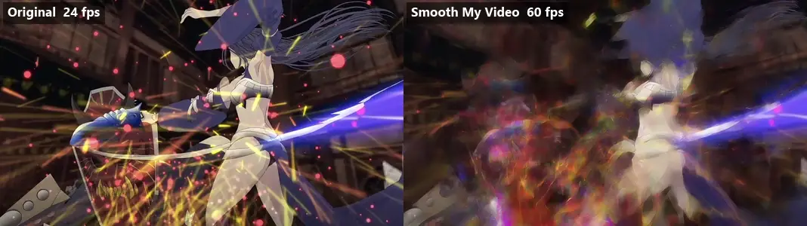
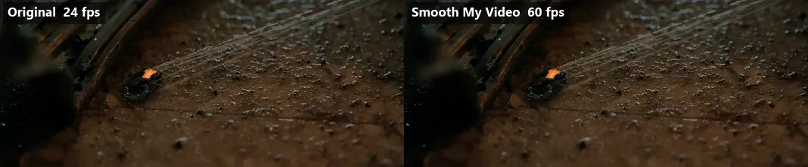
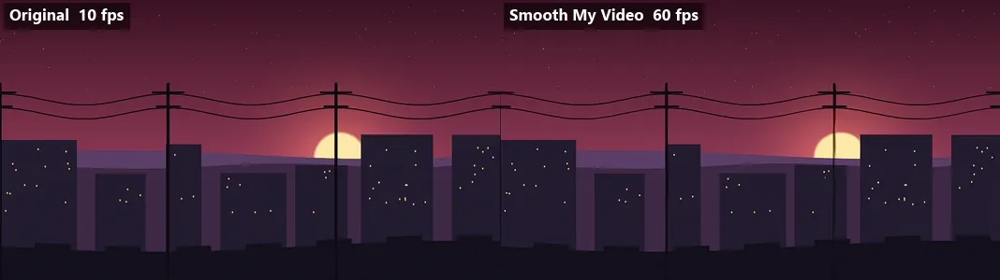
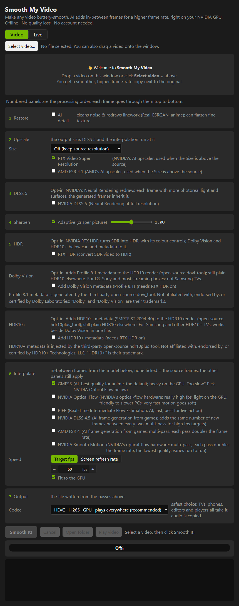
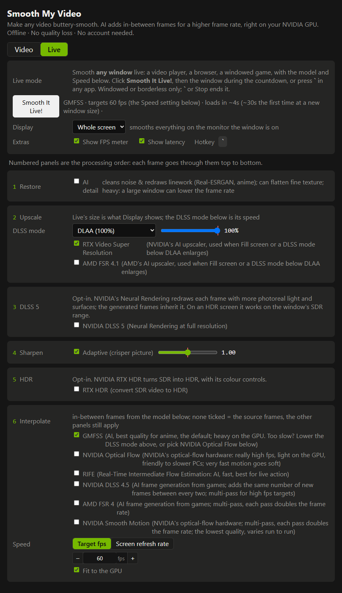
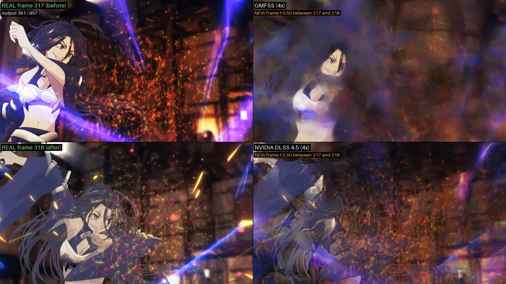

  

<h1 align="center">Smooth My Video</h1>

  <b>Offline AI frame interpolation for NVIDIA GPUs.</b> 
  Drop in a video, pick a target frame rate, and get a buttery-smooth high-FPS copy. 
  No cloud, no subscription, no install.

  
  
  

  <a href="#get-started">Get started</a> ·
  <a href="#models">Models</a> ·
  <a href="#picture">Picture</a> ·
  <a href="#file-renders">File renders</a> ·
  <a href="#live-mode">Live mode</a> ·
  <a href="#under-the-hood">Under the hood</a>

   
  <b>The same scene, before and after.</b> About 8 seconds from episode 1 of <a href="https://sh-anime.shochiku.co.jp/jukishi-anime/"><i>The Exiled Heavy Knight Knows How to Game the System</i></a>, downscaled. Left: the source frames at 24 fps, no interpolation. Right: Smooth My Video's 60 fps render with the default GMFSS model, drawing the frames in between through sparks, blades, camera moves and a backflip. 
  <i>&copy; Nekoko, BroccoLee, Jaian, KODANSHA/"The Exiled Heavy Knight Knows How to Game the System" Production Committee (&copy;猫子・武六甲理衣・じゃいあん・講談社／「追放された転生重騎士はゲーム知識で無双する」製作委員会)</i>

   
  <b>Live action, too.</b> 14 seconds from <a href="https://en.wikipedia.org/wiki/Spider-Man:_Brand_New_Day"><i>Spider-Man: Brand New Day</i></a> (2026), downscaled. Left: the source frames at 24 fps, no interpolation. Right: Smooth My Video's 60 fps render with the default GMFSS model, drawing the frames in between through motion blur, flying debris and web lines. 
  <i>&copy; 2026 Columbia Pictures (Sony Pictures) and Marvel Studios</i>

   
  <b>Slow pans, too.</b> Left: an anime-style pan at 10 fps (drawn procedurally for this README), the cadence anime pans are actually drawn at. Right: interpolated 6&times; to 60 fps. Every original frame passes through untouched; the AI draws only the frames in between.

**Why it exists:** NVIDIA's RTX Video (AI upscaling + RTX HDR) is gorgeous but playback-only: it enhances what you
watch, then throws it away. Smooth My Video applies those same RTX passes, plus AI frame interpolation, straight to
your file, so the result is saved, not just streamed.

---

## Two modes

A **Video / Live** switch at the top of the window picks the mode. Each mode shows only its own controls, plus the
settings both share. The panels are numbered in the order the passes run.

<table>
  <tr>
    <td align="center" width="50%"><b>Video</b>: render a smoother copy of a file</td>
    <td align="center" width="50%"><b>Live</b>: smooth any window in real time</td>
  </tr>
  <tr>
    <td></td>
    <td></td>
  </tr>
  <tr>
    <td valign="top">Pick a video (or several, or drag them in), set a <b>target frame rate</b> and click
    <b>Smooth It!</b>. The smooth copy is written next to the original, with its audio tracks, subtitles and
    chapters carried over.</td>
    <td valign="top">Smooths any window on your screen (a video player, a browser, a windowed game) or the whole
    screen, with no file to render, Lossless-Scaling-style.</td>
  </tr>
</table>

**Speed** works in both modes: type a target fps, or pick **Screen refresh rate** to match your monitor. Video renders
keep the exact rate (59.94 stays 59.94), up to 100&times; the source. A whole multiple of the source rate is
"on-grid" (every original frame is kept), and the **&asymp;** button snaps to the nearest one. Live uses whole fps, up
to 10000.

## Get started

1. Download `SmoothMyVideo-<version>-win.7z` from the
   [latest release](https://github.com/flowreen/SmoothMyVideo/releases/latest) (its `.sha256` and the release notes
   sit beside it).
2. Extract it anywhere. Windows 11 23H2 and later open `.7z` in File Explorer; on older Windows use
   [7-Zip](https://www.7-zip.org/).
3. Run **`SmoothMyVideo.exe`**. A second launch just brings the running window forward.

**Requirements:** an NVIDIA RTX GPU with a current driver. No Python, pip or ffmpeg to install, no account, no cloud
upload, and it is free. Built and tested on an RTX 5090 Laptop.

**Optional extras.** A few features need a file the app can't include. Tick the feature and the app shows a short
setup box; you can also drop the file onto the window (not for Smooth Motion).

| Feature | What to get | How |
|---|---|---|
| RTX Video Super Resolution, RTX HDR | NVIDIA's RTX Video SDK | **Get from NVIDIA**, then **Choose .zip&hellip;** (or drop the zip). Without it, upscaling uses a standard resize and RTX HDR is off. |
| NVIDIA DLSS 5 | The Neural Rendering runtime (`nvngx_dlssnr.dll`) | One-click **Download the DLSS 5 runtime** ([details](#nvidia-dlss-5)), or drop the file. |
| NVIDIA Smooth Motion | `NvOFFRUC.dll` from NVIDIA's Optical Flow SDK | **Get from NVIDIA**, then **Choose .zip&hellip;**. GMFSS is used until it is installed. |
| Dolby Vision, HDR10+ | The open-source [dovi_tool](https://github.com/quietvoid/dovi_tool) / [hdr10plus_tool](https://github.com/quietvoid/hdr10plus_tool) | **Get &hellip;**, then **Choose .zip&hellip;** (or drop the file). |

**From source:** `npm start`. See **[DEVELOPMENT.md](DEVELOPMENT.md)** for the full setup.

## Models

One model at a time; every model works in videos and in Live. **GMFSS** is the default. Untick every model to only
enhance the picture, without adding frames. Hover a row in the app to see its exact version.

| Model | Best for | Needs | Notes |
|---|---|---|---|
| **GMFSS** (default) | Anime | Any RTX GPU | The cleanest frames, even at high multipliers; the heaviest on the GPU. |
| **NVIDIA Optical Flow** | Slower PCs, fast renders, moderate motion | Any RTX GPU | Runs on a dedicated part of the GPU, so it is fast. Very fast motion turns into a soft double image instead of breaking up. Videos need a whole multiplier (2&times;, 3&times; ...). |
| **RIFE** (Practical-RIFE 4.26 heavy) | Live action, filmed content | Any RTX GPU | A strong all-round model. Its **DRBA** option (for anime) keeps characters moving at their drawn pace while camera pans get fully smooth; in Live it adds one frame of delay. |
| **NVIDIA DLSS 4.5** (DLSS Frame Generation) | NVIDIA's game frame generation, on video | RTX 40/50, a recent driver, Windows hardware-accelerated GPU scheduling | Whole multipliers only. Past the GPU's limit (6&times; on an RTX 50, 2&times; on an RTX 40) it goes multi-pass, e.g. 12&times; = 6&times; then 2&times;. |
| **AMD FSR 4** frame generation | A different AI look | Any RTX GPU | AMD's AI frame generation, running on NVIDIA GPUs. Fine edges can break up on fast anime motion, where GMFSS stays clean. Each pass doubles the frame rate (2&times;, 4&times;, 8&times; ...). |
| **NVIDIA Smooth Motion** | Legacy: a non-AI reference | Any RTX GPU | The same technology as the NVIDIA driver's Smooth Motion. The lowest quality of the models. Each pass doubles the frame rate (2&times;, 4&times;, 8&times; ...). |

**Compare to**, in the preview, puts the model you ticked next to another one on the same moment of your video: the
real frames before and after on the left, each model's new frame between them on the right. Step through the new
frames with **&lsaquo; &rsaquo;**, click to zoom all four pictures together, and hold **Space** to swap the two
models. **Save image** keeps what you see; **Save clip** saves the next second as a lossless video of the four
pictures, every frame, to step through in a player.

## Picture

These run before the new frames are made, in videos and in Live:

* 🔍 **Restore**: cleans up compression noise and blur (Real-ESRGAN); it can flatten fine texture. Off by
  default.
* 📐 **Upscale**: makes the picture bigger and sharper with NVIDIA RTX Video Super Resolution (on by default) or AMD
  FSR 4.1; with neither ticked, a standard resize. They only run when the picture is enlarged.
* 🧠 **NVIDIA DLSS 5** (optional): NVIDIA's Neural Rendering, an AI picture enhancement on every original frame.
  [Details](#nvidia-dlss-5).
* ✏️ **Sharpen**: bacondither's Adaptive Sharpen, strength 0 to 2 (on at 1.00 by default).
* 🎨 **RTX HDR**: turns normal (SDR) video into HDR, with **Contrast** and **Saturation** sliders, plus optional
  **RTX Dynamic Vibrance** (richer colours, skin tones kept). HDR sources stay as they are.

In the preview, **Show changed pixels** turns the Processed pane into a heat map of where DLSS 5 changed the picture.

## File renders

* 🎯 **On-grid keeps the real frames.** At a whole multiple of the source rate (2&times;, 3&times; ...), every original
  frame is kept and the AI only draws the frames in between. At other targets every output frame is a new one. A
  still picture stays perfectly still.
* 📏 **One Size control.** Pick the output **Size**: Off, your screen's resolution, 720p up to 8640p, or a custom
  height (240p to 16K). Above 4K, the AI work runs at 4K and the result is enlarged at the end.
* 🌈 **Proper HDR10**, with real brightness data and accurate colour. Optional **Dolby Vision** (plays as HDR10 where
  Dolby Vision isn't supported) and **HDR10+**, together or apart. Both need RTX HDR, HEVC and an MP4 file; the app
  tells you when it has to skip them.
* 🗜️ **Visually lossless, 10-bit.** HEVC (default), AV1 or H.266 (VVC), at top quality with no knob to guess at.
  10-bit output keeps skies and glows free of banding.
* 💬 **Keeps your tracks.** All audio, subtitles / translations and chapters are copied, and the output switches to
  `.mkv` when MP4 cannot carry a track. Font attachments are kept in `.mkv` outputs.
* 📱 **Handles real-world files.** Phone clips and screen recordings with a changing frame rate stay in sync, HDR
  sources stay HDR, and DVDs and other stretched formats keep their shape.
* 🔁 **Reproducible.** The same file with the same settings renders byte-for-byte identically, every time, except
  with the NVIDIA Smooth Motion and AMD FSR 4 models.
* ⏯️ **Pause, preview, resume.** **Pause** holds the render; **Play preview** opens the part done so far, with sound
  and subtitles. A render that was closed or crashed continues where it stopped (with the same settings and an
  unchanged source). **Cancel** deletes the partial file. A render never leaves a cut-off file behind.
* 🧺 **Set-and-forget batches.** Pick or drop several files: they render one after another with the same settings, a
  file that fails is noted and the rest keep going, and a batch interrupted by a crash or restart is queued again on
  the next launch.
* 📊 **Always in view.** Frames, render fps, an ETA with the finish time and the projected file size (with a warning
  when the drive is too small), a thumbnail of the frame being written, taskbar progress, and a notification when a
  render or batch finishes while the window is in the background. Your PC will not sleep mid-render.

<b>More: preview, output names, very large outputs, first runs</b>

* **Before / after preview:** a still frame with your Restore, resize, DLSS 5, Sharpen and HDR settings, next to the
  original. It updates as you change settings; step to a random frame, and click either image for a synced 1:1 pixel
  view.
* **Output name:** `<name>_<fps>fps` (the fps rounded, so 59.94 gives `_60fps`; plus `_<height>p` when resized) next
  to the source, `.mp4` or `.mkv` as needed. With no model ticked it is `_<height>p`, or `_restored` / `_dlss5` /
  `_sharpened` / `_hdr` after the pass that runs. Edit the **Saves to** path in place or with **Change&hellip;**;
  clearing it brings the automatic name back. After a render, **Open folder** or **Play video**.
* **Outputs above 8192 px** encode on the CPU (AV1 or VVC); the app checks your free memory first (a 16K render
  needs about 54 GB), and RTX HDR stops at 8192 px.
* **Colour** stays accurate: conversions use exact math, and a file with no colour tags gets the usual standard for
  its size.
* **First run at a new size** prepares the AI models for it once (kept in `model_cache_safe_to_delete` in the app's
  folder, safe to delete); later runs start fast.
* **Laptops:** the app tells you when a "Silent" power profile is slowing the GPU.
* **The engine log** is `%TEMP%\smv-engine.log`; an error line in the app points at it.

## Live mode

Real-time frame generation on any window: the Lossless-Scaling-style feature, built in and free.

* **Start:** press the **hotkey** (` by default, changeable with the **Hotkey** button) in any app, or click
  **Smooth It Live!** and then click the window you want within 5 seconds.
* **Stop:** press the hotkey again, or click **Stop**. The hotkey is reserved system-wide while the app runs.
* **Display:** **Whole screen** (the default) smooths the whole monitor the active window is on, everything on it, and
  works with every model including DLSS 4.5. **Original size** smooths only the window. **Fill screen** fills its
  monitor with the window (aspect kept), upscaled with RTX VSR or AMD FSR 4.1 when ticked.
* **Adaptive:** with GMFSS, RIFE or NVIDIA Optical Flow the output holds your fps target whatever the source does (a
  game dropping from 30 to 10 fps still plays at the same smooth rate). AMD FSR 4 and Smooth Motion double the frame
  rate per pass, so they pick the doubling that reaches your target (60 fps on a 24 fps source shows 96); DLSS 4.5
  picks the first whole multiple that does.
* **Fit to the GPU** (on by default) lowers the frame rate to what your GPU can keep up with, never below the source,
  with every effect kept. Unticked, a target the GPU can't reach makes it skip frames.
* **Readout:** a small green corner readout shows the source fps, the smoothed fps, and roughly how far the picture
  runs behind reality: about a source frame, made for watching, not for competitive play. **Show FPS meter** turns it
  off; **Show latency** hides its latency part.
* **The first session at a new window size** takes a while to prepare (about 30 s for GMFSS, 45 s for RIFE, 55 s
  with DRBA); later ones start in seconds.
* **Windowed or borderless windows only** (exclusive fullscreen can't be captured).

<b>More: DLSS mode, effects, HDR displays, what pauses and restarts it</b>

* **DLSS mode** trades sharpness for speed: the work runs at a smaller size, then the picture is enlarged. DLAA (the
  default) is the full size; Quality 67%, Balanced 58%, Performance 50%, Ultra Performance 33%, or any size down to 1%
  with the slider. Lower is faster and softer.
* **Effects** (Restore, DLSS 5, Sharpen, the upscaler) work with every model, DLSS 4.5 included. Untick every model
  to get just the effects, at the window's own frame rate.
* **On an HDR display** every model runs in HDR, and RTX HDR can turn SDR windows into HDR.
* **Pauses by itself** when the window is minimized, on another virtual desktop, or covered by the window in front,
  and resumes when it is back.
* **Restarts by itself**, on the same window, when you change the Speed target, the DLSS mode or Fit to the GPU, when
  the window is resized or moved to another monitor, and if the engine stalls. A closed window stops Live.
* **Fill screen and the mouse:** clicks on the stretched picture reach the matching spot of your window, and the
  pointer speed follows the stretch; the normal pointer comes back when the cursor leaves the picture or Live stops.
* **Fast restarts:** the loaded model stays ready after Stop, so the next session starts faster (not after DLSS 4.5,
  DLSS 5 or RTX HDR); it is freed after 10 idle minutes or when you pick another model.
* **RivaTuner (RTSS):** if it hooks the overlay, the engine log (`%TEMP%\smv-engine.log`) names it, with the fix.

## NVIDIA DLSS 5

One checkbox runs NVIDIA's DLSS 5 Neural Rendering on every original frame, in videos and in Live.

<b>Where it runs, its controls, and the one-click download</b>

* **Where:** after Restore and the resize, at the output size up to 4K (in Live, at the DLSS mode's size).
* **How:** fed the way games feed it, so it follows the motion, and a paused picture stays perfectly still.
* **Controls:** NVIDIA's three looks as a **Style** selector (Default, Natural, Cinematic; Default is preselected),
  **Structure Intensity** and **Tone Intensity** sliders, and **Passes** (1 to 20): DLSS 5 again on its own result,
  for a stronger effect at that many times the time and video memory.
* **The download:** NVIDIA's Neural Rendering file (`nvngx_dlssnr.dll`) isn't included, and NVIDIA offers no download for it.
  The one-click **Download the DLSS 5 runtime** button fetches the community RTX 40 + 50 build
  ([rhi-repo](https://github.com/RankFTW/rhi-repo/releases) on GitHub), checks it and installs it. Already have the
  file? Drop it on the window.
* **In Live:** on every captured frame of SDR content.

## Everyday comforts

* Most settings are remembered between runs (Restore and RTX Dynamic Vibrance start off each launch), and so is the
  window size.
* Zoom the interface with Ctrl+= / Ctrl+- / Ctrl+0, or Ctrl + mouse wheel.
* The source panel shows the resolution, the frame rate (the exact fraction on hover), the duration and the codec,
  plus the track counts when there is more than one audio track or any subtitle.
* A quiet one-line notice appears when a newer release is out (nothing auto-downloads).

## Under the hood

The UI is Electron + TypeScript. Every render and Live session runs in one native host (`smv-live.exe`, C++ on
TensorRT for RTX and CUDA), driven by a TypeScript orchestrator that handles probing, encoding (ffmpeg) and resume;
DLSS 4.5 file renders run NVIDIA's frame generation in a small separate helper. No Python ships. The default model,
**GMFSS_Fortuna**, is a "union" interpolator: GMFlow optical flow, an IFNet/RIFE refiner, plus MetricNet, FeatureNet,
FusionNet and softsplat warping.

File renders also run without the window: `node dist\render\cli.js <input> <multiplier> [output] [flags]` takes the
same settings the GUI builds, and the native host can start Live on a window by its title.

📖 **Every flag, the build and the design rationale: [DEVELOPMENT.md](DEVELOPMENT.md)**

## Contributing

Smooth My Video was built end to end by AI coding agents ([Claude Code](https://claude.com/claude-code)), and it's
meant to keep growing that way. If there's a feature you want, open an issue and describe it, or send a pull request.
Contributions are welcome whether you write the code yourself or hand the idea to an agent, exactly how the rest of
this app was built.

---

Dolby and Dolby Vision are trademarks of Dolby Laboratories. Smooth My Video is an independent project and
is not affiliated with, endorsed by, sponsored by, or certified by Dolby Laboratories. Dolby Vision Profile
8.1 metadata is produced by the separately-installed, third-party open-source
[dovi_tool](https://github.com/quietvoid/dovi_tool); no Dolby software is bundled or redistributed.
HDR10+ is a trademark of HDR10+ Technologies, LLC; Smooth My Video is likewise not affiliated with, endorsed
by, or certified by HDR10+ Technologies. HDR10+ metadata is injected by the separately-installed, third-party
open-source [hdr10plus_tool](https://github.com/quietvoid/hdr10plus_tool); no HDR10+ LLC software is bundled
or redistributed.

The anime and film demo clips above (`docs/demo-fight.webp`, `docs/demo-spiderman.webp`) are short excerpts used
only to show what Smooth My Video does. The footage belongs to its copyright holders, credited under each clip, and is
not covered by this project's MIT license; Smooth My Video is not affiliated with or endorsed by them. Rights holders
who want a clip removed can [open an issue](https://github.com/flowreen/SmoothMyVideo/issues) and it will be taken
down promptly.
